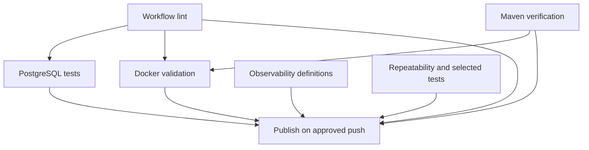

# HlambaQ CI/CD architecture

This repository keeps a coordinated verification and publishing workflow. Its jobs are the responsibility boundaries; a separate top-level release workflow would need cross-workflow trust and artifact handling without improving the current safety model. Application-specific observability, tests, thresholds and runtime checks stay beside the application. Issue [#197](https://github.com/ongeziwe17/hlambaq/issues/197) tracks a later, separately proven reusable-pipeline pilot.

## Baseline inventory and change

The reviewed `staging` baseline was `35ecfe42b4c89c184a72c6a5a9dc7b8c0e298e79`. Before this refactor, `.github/workflows/ci-cd.yml` had seven jobs in 753 lines. `workflow-lint` combined actionlint, whitespace, publishing templates, observability definition checks and a non-blocking test-isolation pattern audit. The other jobs already separated Maven, PostgreSQL, repeatability, selected tests, Docker and publishing. `bruno-acceptance.yml` independently exercised PostgreSQL-backed HTTP acceptance, and `branch-protection.yml` enforced promotion sources.

Now `observability-validation` independently validates monitoring definitions, while the pattern audit lives at the start of `isolated-test-selection`. `workflow-lint` owns workflow/release-metadata correctness and a [pipeline safety contract](../tools/ci/validate-pipeline.py) with [failure-path fixtures](../tools/ci/test-pipeline-contract.py). The Docker job retains the one built image for runtime, security and observability smoke tests; its longer runtime commands live in [container-runtime.sh](../tools/ci/container-runtime.sh). After Buildx loads the image, a local tag lets Compose use `--no-build`. This avoids a second Compose build without sharing untrusted artifacts across jobs. The Docker job still runs Hadolint, ignore/history checks, PostgreSQL-backed restart, direct image smoke, optional observability, Trivy report and blocking fixed-critical gate.

The existing job IDs and displayed check names are unchanged; the new `Observability configuration validation` check is an additional explicit publish prerequisite. `Bruno API acceptance` and `check-branch` are unchanged.

## Triggers and job responsibility

| Workflow / job (check name) | Events | Needs | Inputs, secrets and permissions | Output or side effect / failure |
| --- | --- | --- | --- | --- |
| `ci-cd.yml`: `workflow-lint` (Workflow syntax validation) | PR to `staging`, `develop`, `master`; pushes to those branches and `v*` tags | None | Checkout history; actionlint 1.7.12; PyYAML 6.0.2; `contents: read`; no secrets | Whitespace, syntax, publishing metadata and static release-safety contract; failure blocks Docker, PostgreSQL and publishing. |
| `observability-validation` (Observability configuration validation) | Same CI events | None | Docker Compose, Prometheus 3.5.5, OTel Collector 0.136.0, Python/PyYAML; read-only token; no secrets | Validates definitions, Prometheus rules/tests, collector and dashboard semantics; failure blocks publishing. |
| `maven-verification` (Maven verification) | Same CI events | None | Java 21, Maven cache, `CI_JWT_SECRET`, test profile; read-only token | `clean verify`, 80% line-coverage/architecture/OpenAPI gates, Spring/Tomcat alignment, reports, JaCoCo, JAR and exported OpenAPI artifact; failure blocks Docker and publishing. |
| `postgres-verification` (PostgreSQL migrations, durability and concurrency) | Same CI events | Workflow syntax validation | Java 21, Docker/Testcontainers, `CI_JWT_SECRET`; read-only token | Focused PostgreSQL `verify`, migration/durability/concurrency and query-plan reports; failure blocks publishing. |
| `test-repeatability` (Test repeatability, one check per seed) | Same CI events | None | Java 21, `CI_JWT_SECRET`; seeds `11001` and `11002`; read-only token | Full `clean verify` per seed; uploads reports on failure; either failure blocks publishing. |
| `isolated-test-selection` (Selected test isolation) | Same CI events | None | Java 21, `CI_JWT_SECRET`; read-only token | Pattern audit plus unchanged independent service, booking, RBAC, management, tracing and pagination tests; failure reports uploaded and publishing blocked. |
| `docker-validation` (Docker validation) | Same CI events | Workflow syntax validation; Maven verification | Docker, Buildx, Hadolint, Trivy, `CI_JWT_SECRET`; read-only token | One non-publishing image build, Compose/runtime/observability smoke and vulnerability artifacts; failure blocks publishing. The `always()` cleanup removes only disposable CI containers/data. |
| `publish-container` (Publish container image) | Approved branch/tag **pushes only** | All seven verification jobs above | Full checkout, Docker Hub username/password, `GITHUB_TOKEN`; only job with `packages: write` | Tag ancestry and credential checks, registry logins, unchanged image metadata/tags, build and push. Skipped on PRs; any failed/cancelled/skipped prerequisite prevents it from starting. |
| `bruno-acceptance.yml`: `bruno-acceptance` (Bruno API acceptance) | PRs and branch pushes; **not tags** | Independent workflow | Java 21, Node 22, disposable PostgreSQL, ephemeral JWT/Bruno/scrape credentials; `contents: read` | Full Maven verification, OpenAPI inventory, business and management Bruno suites, reports and API cleanup; never publishes. Its trigger/dependency model is unchanged. |
| `branch-protection.yml`: `check-branch` | PRs only | Independent workflow | PR base/head refs; `contents: read` | Requires work branches into staging, staging into develop, develop into master; failure blocks promotion when configured as required. |

The top-level CI and Bruno workflows cancel older runs for the same PR/ref. The image-publishing job uses the implicit GitHub Actions successful-`needs` condition plus its exact push/ref restriction; it does **not** use `always()`, `workflow_run` or `pull_request_target`. Docker Hub credentials appear only in publishing. `CI_JWT_SECRET` stays in test/runtime jobs; Bruno generates independent ephemeral secrets. Test reports, JaCoCo, JAR, OpenAPI, PostgreSQL plans, seed/selected-test failure reports, Bruno reports and Trivy JSON retain their names, conditions and 14-day retention.

The Bruno and promotion workflows run independently; the main publishing job has never waited for the separate Bruno workflow. Branch protection should require its acceptance check where desired. No cross-workflow publishing shortcut was introduced.

## Before/after contract

| Area | Baseline | After |
| --- | --- | --- |
| PR, branch push, `v*` tag triggers | CI on all three targets, branches and tags; Bruno on PR/branch push; promotion on PR | Identical; validated by the safety contract and actual PR runs. |
| Required check identities | Workflow syntax, Maven, PostgreSQL, both seeds, selected tests, Docker, Bruno, `check-branch` | Unchanged; adds one observability check. Check contexts must be compared in Actions, since YAML names alone are insufficient. |
| Dependencies | Docker after lint/Maven; PostgreSQL after lint; publish after six jobs | Same dependencies plus direct publish dependency on observability; the observability check runs in parallel rather than inside lint. |
| Verification | Existing commands, tool pins, thresholds and reports | Preserved. Pattern audit moved to selected tests; monitoring definitions moved to parallel check. |
| Security | One non-publishing PR image, fixed-critical Trivy gate, read-only default token | Preserved; publishing alone has package write and Docker credentials. One built image is tagged locally for Compose. |
| Publishing | Approved pushes only, master-reachable `v*` tag, credentials required | Unchanged Docker Hub/GHCR image names, nine metadata tag rules and successful prerequisite condition. |
| Failure/cancellation | Failed prerequisite prevents publication | Preserved; static mutation fixtures exercise gate removal, permissive conditions, tag/provenance, credential and vulnerability regressions. |

The static validator is a guard against known unsafe edits, not an Actions interpreter. No image is published to test denial paths. Tag-push publishing and absent-credential failure remain unexercised on this PR; their conditions are inspected statically and must be observed at an authorized future release. Repository rulesets are managed outside this PR; no protection setting is modified.

## Troubleshooting and local checks

Look at **Workflow syntax validation** for YAML, actionlint and release metadata; **Observability configuration validation** for Prometheus, alerts, collector and dashboard configuration; **Maven verification** for build, coverage, architecture, OpenAPI and dependency alignment; **PostgreSQL migrations, durability and concurrency** for database behavior; the seed and selected-test jobs for reliability; **Docker validation** for image, Compose, runtime, security and optional monitoring smoke; **Bruno API acceptance** for HTTP behavior; **Publish container image** for tag ancestry, credentials and registry failures; and **check-branch** for promotion source errors.

From the repository root, `python3 tools/ci/validate-pipeline.py` reads the workflow graph and exits on a contract violation; it changes no repository or system state and requires PyYAML. `python3 tools/ci/test-pipeline-contract.py` creates temporary mutated YAML fixtures, expects the validator to reject them and cleans the temporary files; it does not publish or edit the repository. `bash -n tools/ci/container-runtime.sh` checks shell syntax without running Docker. `./mvnw --batch-mode clean verify` compiles and tests Java, writes `target/` reports/JAR and needs Docker for the PostgreSQL Testcontainers test. Docker/Compose runtime checks start disposable local containers and should be run only in a suitable development/CI environment. The Actions job uses pinned validation images and uploads failure artifacts.

## Future extraction (#197)

Generic candidates are actionlint setup, Java/Maven setup, artifact upload patterns and the narrowly parameterized image build after one more consumer demonstrates value. HlambaQ's test classes/seeds, coverage floor, dependency pins, OpenAPI/Bruno inventory, Docker runtime script, observability definitions and alert rules stay application-owned. Release event policy, tag ancestry, image names, permissions and secrets remain explicit in the application caller until a versioned or SHA-pinned reusable pilot proves identical check contexts, results and rollback. The planned `hlambaq-pipelines` repository is not created by this change.
